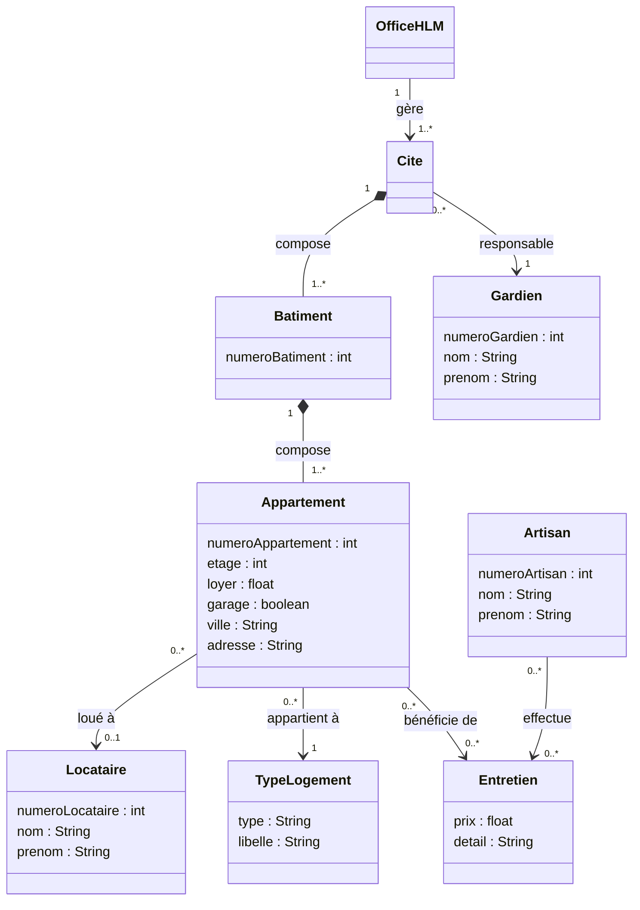

Donne moi STP le diagramme de classes UML pour ce cahier des charges: Un office HLM gère des cités composées de bâtiments, eux-mêmes composés d’appartements. Ces appartements
sont libres ou loués à des locataires. Un locataire peut louer plusieurs appartements. Un appartement,
s’il est loué, n’a qu’un seul locataire. Certaines informations sont nécessaires à la bonne gestion de chaque
appartement comme, par exemple, l’étage où il se trouve, le montant de son loyer, si un garage y est affecté,
la ville et l’adresse où il se trouve, le nom et le prénom de son locataire (s’il en a un). Dans chaque cité, les bâtiments sont numérotés séquentiellement à partir de 1. De même, dans un bâtiment,
les appartements sont numérotés séquentiellement à partir de 1.
Chaque cité est sous la responsabilité d’un unique gardien, lui-même pouvant avoir plusieurs cités à sa
charge. On souhaite stocker le nom et le prénom de chaque gardien. Un gardien est identifié par un numéro
unique.
Chaque appartement appartient à type de logement (F1 à F6) correspondant à un certain nombre de
caractéristiques précises regroupées sous la forme d’un libellé.
Pour chaque appartement, des opérations d’entretien peuvent être effectuées par des artisans. On souhaite
stocker les noms et prénoms des artisans, ces derniers sont identifiés par un numéro. Pour chaque opérations
d’entretiens, on souhaite stocker le prix et le détail de l’opération.

Voici une proposition de diagramme de classes UML correspondant au cahier des charges, avec les classes, leurs attributs, les associations et les cardinalités.

1. Identification des classes

Le cahier des charges permet d’identifier 7 classes :

Classe	Attributs
OfficeHLM	—
Cite	nom (facultatif)
Batiment	numeroBatiment
Appartement	numeroAppartement, étage, loyer, garage, ville, adresse
Locataire	numeroLocataire, nom, prenom
Gardien	numeroGardien, nom, prenom
TypeLogement	type (F1 à F6), libelle
Artisan	numeroArtisan, nom, prenom
Entretien	prix, detail

En réalité, cela fait 9 classes si l’on distingue les opérations d’entretien des artisans et des types de logements.

⸻

2. Diagramme de classes UML

Voici le diagramme avec les associations et les cardinalités :

classDiagram
class OfficeHLM
class Cite {
}
class Batiment {
    numeroBatiment : int
}
class Appartement {
    numeroAppartement : int
    etage : int
    loyer : float
    garage : boolean
    ville : String
    adresse : String
}
class Locataire {
    numeroLocataire : int
    nom : String
    prenom : String
}
class Gardien {
    numeroGardien : int
    nom : String
    prenom : String
}
class TypeLogement {
    type : String
    libelle : String
}
class Artisan {
    numeroArtisan : int
    nom : String
    prenom : String
}
class Entretien {
    prix : float
    detail : String
}
OfficeHLM "1" --> "1..*" Cite : gère
Cite "1" *-- "1..*" Batiment : compose
Batiment "1" *-- "1..*" Appartement : compose
Appartement "0..*" --> "0..1" Locataire : loué à
Cite "0..*" --> "1" Gardien : responsable
Appartement "0..*" --> "1" TypeLogement : appartient à
Appartement "0..*" --> "0..*" Entretien : bénéficie de
Artisan "0..*" --> "0..*" Entretien : effectue

⸻

3. Explication des associations et cardinalités

A. Office HLM – Cité

* Un office HLM gère plusieurs cités.
* Une cité est gérée par un seul office HLM.

Cardinalités : OfficeHLM (1) → Cite (1..*)

B. Cité – Bâtiment

* Une cité est composée d’un ou plusieurs bâtiments.
* Un bâtiment appartient à une seule cité.
* Les bâtiments sont numérotés séquentiellement au sein d’une cité (à partir de 1).

Cardinalités : Cite (1) → Batiment (1..*)

Le numéro du bâtiment n’est donc pas forcément unique dans tout l’office HLM, mais uniquement au sein de sa cité.

C. Bâtiment – Appartement

* Un bâtiment est composé d’un ou plusieurs appartements.
* Un appartement appartient à un seul bâtiment.
* Les appartements sont numérotés séquentiellement au sein de leur bâtiment (à partir de 1).

Cardinalités : Batiment (1) → Appartement (1..*)

D. Appartement – Locataire

* Un appartement peut être libre (aucun locataire) ou loué à un seul locataire.
* Un locataire peut louer plusieurs appartements.

Cardinalités :

* Un appartement : 0..1 locataire.
* Un locataire : 0..* appartements.

E. Cité – Gardien

* Chaque cité est sous la responsabilité d’un unique gardien.
* Un gardien peut être responsable de plusieurs cités.

Cardinalités :

* Une cité : 1 gardien.
* Un gardien : 0..* cités.

F. Appartement – TypeLogement

* Chaque appartement appartient à un type de logement (F1 à F6).
* Un type de logement peut concerner plusieurs appartements.

Cardinalités :

* Un appartement : 1 type de logement.
* Un type de logement : 0..* appartements.

Le libellé permet de décrire les caractéristiques du type de logement.

G. Appartement – Entretien – Artisan

* Un appartement peut faire l’objet de plusieurs opérations d’entretien.
* Une opération d’entretien concerne un seul appartement.
* Chaque opération d’entretien est effectuée par un artisan.
* Un artisan peut effectuer plusieurs opérations d’entretien, éventuellement sur différents appartements.

Chaque opération d’entretien possède un prix et un détail.

⸻

4. Quelques remarques de modélisation

* Numérotation des bâtiments : numeroBatiment doit être unique à l’intérieur d’une cité, mais pas nécessairement globalement.
* Numérotation des appartements : numeroAppartement doit être unique à l’intérieur d’un bâtiment.
* Garage : l’attribut garage est de type booléen (true ou false).
* Loyer : l’attribut loyer pourrait être de type Decimal plutôt que float pour éviter les problèmes de précision liés aux montants financiers.
* Locataire : le nom et le prénom du locataire ne sont pas stockés dans la classe Appartement, puisqu’ils sont accessibles via l’association avec la classe Locataire.
* Entretien : j’ai modélisé chaque opération d’entretien comme une classe à part entière, car elle possède des informations propres (prix et détail) et est liée à un artisan.

Si tu veux, je peux aussi te fournir une version du diagramme UML sous forme d’image propre (avec les rectangles UML, attributs et cardinalités), prête à être utilisée dans un cours ou un sujet d’examen.

Donne moi les ordres SQL de création de la base de données PostGres

Voici les instructions SQL de création de la base de données PostgreSQL, correspondant au diagramme UML précédent.

J’ai retenu les choix suivants :

* Les identifiants sont des clés primaires (PRIMARY KEY) auto-générées.
* Une cité possède plusieurs bâtiments, et chaque bâtiment plusieurs appartements.
* Le numéro de bâtiment est unique au sein d’une cité.
* Le numéro d’appartement est unique au sein d’un bâtiment.
* Un appartement peut être vacant ou loué à un seul locataire.
* Chaque cité a un gardien unique.
* Les opérations d’entretien sont modélisées par une table dédiée.

1. Création de la base de données

CREATE DATABASE office_hlm;

Pour se connecter à la base de données nouvellement créée (dans psql) :

\c office_hlm

⸻

2. Création des tables

Table office_hlm

CREATE TABLE office_hlm (
    id_office SERIAL PRIMARY KEY
);

Table gardien

Un gardien peut être responsable de plusieurs cités, mais une cité n’a qu’un seul gardien.

CREATE TABLE gardien (
    id_gardien SERIAL PRIMARY KEY,
    nom VARCHAR(100) NOT NULL,
    prenom VARCHAR(100) NOT NULL
);

Table cite

Une cité est rattachée à un office HLM et à un gardien.

CREATE TABLE cite (
    id_cite SERIAL PRIMARY KEY,
    id_office INTEGER NOT NULL,
    id_gardien INTEGER NOT NULL,
    FOREIGN KEY (id_office)
        REFERENCES office_hlm(id_office),
    FOREIGN KEY (id_gardien)
        REFERENCES gardien(id_gardien)
);

Table batiment

Le numéro du bâtiment est unique au sein d’une cité.

CREATE TABLE batiment (
    id_batiment SERIAL PRIMARY KEY,
    numero_batiment INTEGER NOT NULL,
    id_cite INTEGER NOT NULL,
    FOREIGN KEY (id_cite)
        REFERENCES cite(id_cite),
    UNIQUE (id_cite, numero_batiment),
    CHECK (numero_batiment >= 1)
);

Table locataire

CREATE TABLE locataire (
    id_locataire SERIAL PRIMARY KEY,
    nom VARCHAR(100) NOT NULL,
    prenom VARCHAR(100) NOT NULL
);

Table type_logement

Les types de logements sont définis de F1 à F6. Le libellé permet de décrire les caractéristiques du logement.

CREATE TABLE type_logement (
    id_type SERIAL PRIMARY KEY,
    type VARCHAR(2) NOT NULL UNIQUE,
    libelle TEXT NOT NULL,
    CHECK (type IN ('F1', 'F2', 'F3', 'F4', 'F5', 'F6'))
);

Table appartement

Un appartement appartient à un bâtiment et à un type de logement. Il peut être vacant (sans locataire) ou loué à un locataire.

CREATE TABLE appartement (
    id_appartement SERIAL PRIMARY KEY,
    numero_appartement INTEGER NOT NULL,
    id_batiment INTEGER NOT NULL,
    id_type INTEGER NOT NULL,
    id_locataire INTEGER,
    etage INTEGER NOT NULL,
    loyer NUMERIC(10,2) NOT NULL,
    garage BOOLEAN NOT NULL DEFAULT FALSE,
    ville VARCHAR(100) NOT NULL,
    adresse VARCHAR(255) NOT NULL,
    FOREIGN KEY (id_batiment)
        REFERENCES batiment(id_batiment),
    FOREIGN KEY (id_type)
        REFERENCES type_logement(id_type),
    FOREIGN KEY (id_locataire)
        REFERENCES locataire(id_locataire),
    UNIQUE (id_batiment, numero_appartement),
    CHECK (numero_appartement >= 1),
    CHECK (loyer >= 0)
);

La colonne id_locataire est nullable : lorsqu’elle vaut NULL, l’appartement est libre. Un locataire peut apparaître dans plusieurs appartements, puisqu’il n’y a pas de contrainte UNIQUE sur cette colonne.

Table artisan

CREATE TABLE artisan (
    id_artisan SERIAL PRIMARY KEY,
    nom VARCHAR(100) NOT NULL,
    prenom VARCHAR(100) NOT NULL
);

Table entretien

Chaque opération d’entretien concerne un appartement et est effectuée par un artisan.

CREATE TABLE entretien (
    id_entretien SERIAL PRIMARY KEY,
    id_appartement INTEGER NOT NULL,
    id_artisan INTEGER NOT NULL,
    prix NUMERIC(10,2) NOT NULL,
    detail TEXT NOT NULL,
    FOREIGN KEY (id_appartement)
        REFERENCES appartement(id_appartement),
    FOREIGN KEY (id_artisan)
        REFERENCES artisan(id_artisan),
    CHECK (prix >= 0)
);

⸻

3. Vue d’ensemble du schéma relationnel

Voici les relations entre les tables :

OFFICE_HLM
    |
    | 1,N
    |
   CITE -------- GARDIEN
    |               |
    | 1,N           | 1,N
    |
 BATIMENT
    |
    | 1,N
    |
 APPARTEMENT -------- LOCATAIRE
    |                    |
    | N,1                | 0,N
    |
 TYPE_LOGEMENT
    |
    | 1,N
    |
 APPARTEMENT
    |
    | 1,N
    |
 ENTRETIEN -------- ARTISAN

Relations et contraintes

Relation	Cardinalité	Implémentation SQL
Office – Cité	1 à N	id_office dans cite
Gardien – Cité	1 à N	id_gardien dans cite
Cité – Bâtiment	1 à N	id_cite dans batiment
Bâtiment – Appartement	1 à N	id_batiment dans appartement
Locataire – Appartement	0 à N	id_locataire nullable dans appartement
Type – Appartement	1 à N	id_type dans appartement
Appartement – Entretien	1 à N	id_appartement dans entretien
Artisan – Entretien	1 à N	id_artisan dans entretien

⸻

4. Insertion des types de logement (F1 à F6)

Il est possible de préremplir la table type_logement avec les six types de logements :

INSERT INTO type_logement (type, libelle) VALUES
('F1', 'Logement comprenant une pièce principale'),
('F2', 'Logement comprenant deux pièces principales'),
('F3', 'Logement comprenant trois pièces principales'),
('F4', 'Logement comprenant quatre pièces principales'),
('F5', 'Logement comprenant cinq pièces principales'),
('F6', 'Logement comprenant six pièces principales');

Les libellés peuvent naturellement être modifiés selon les caractéristiques précises que l’office HLM souhaite gérer.

⸻

5. Quelques exemples de requêtes SQL

Liste des appartements avec leurs locataires

SELECT
    a.id_appartement,
    a.numero_appartement,
    a.etage,
    a.loyer,
    a.ville,
    a.adresse,
    l.nom AS nom_locataire,
    l.prenom AS prenom_locataire
FROM appartement a
LEFT JOIN locataire l ON a.id_locataire = l.id_locataire;

Liste des appartements libres

SELECT *
FROM appartement
WHERE id_locataire IS NULL;

Liste des cités gérées par chaque gardien

SELECT
    g.nom,
    g.prenom,
    c.id_cite
FROM gardien g
JOIN cite c ON c.id_gardien = g.id_gardien
ORDER BY g.nom, g.prenom;

Liste des entretiens réalisés sur un appartement

SELECT
    e.detail,
    e.prix,
    ar.nom AS nom_artisan,
    ar.prenom AS prenom_artisan
FROM entretien e
JOIN artisan ar ON e.id_artisan = ar.id_artisan
WHERE e.id_appartement = 1;

⸻

Si tu le souhaites, je peux également te fournir un script SQL complet dans un seul fichier .sql, directement exécutable dans PostgreSQL avec la création de toutes les tables, les contraintes et quelques données de test.

Voici le fichier SQL complet, prêt à être exécuté sur PostgreSQL.

📄 Télécharger le fichier office_hlm.sql⁠

Le fichier contient :

* La création des 9 tables.
* Les clés primaires et clés étrangères.
* Les contraintes d’intégrité (NOT NULL, CHECK, UNIQUE).
* La gestion des appartements vacants ou loués.
* La numérotation des bâtiments et appartements au sein de leur parent.
* Les types de logement F1 à F6 préinsérés.
* Quelques requêtes SQL d’exemple, commentées.

Exécution

Avec psql :

1. Créer la base :

CREATE DATABASE office_hlm;

2. Se connecter :

psql -d office_hlm

3. Exécuter le script :

\i office_hlm.sql

Attention : le script supprime les tables existantes avant de les recréer. Il est donc prévu pour une installation initiale ou un environnement de test, pas pour une base contenant des données à conserver. 
